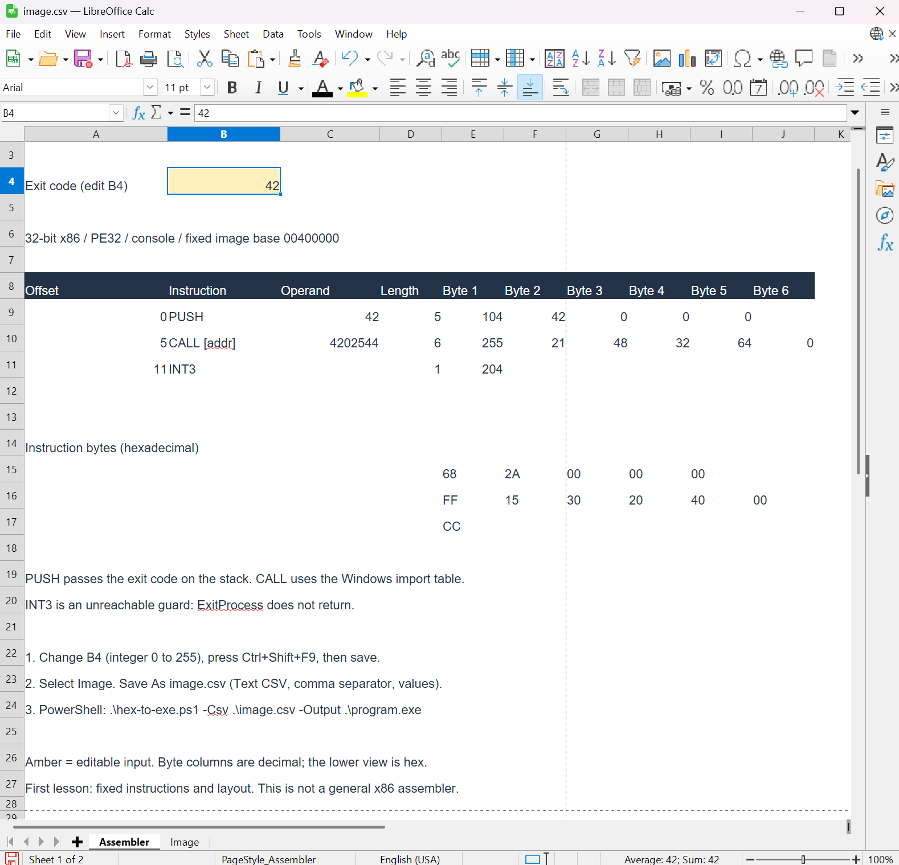
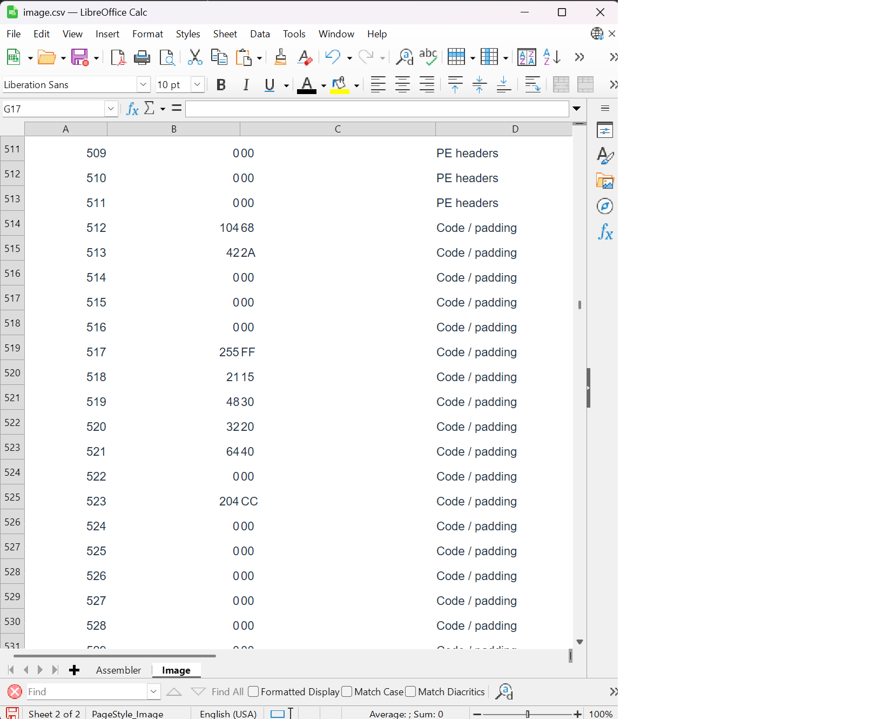

# Lesson 1: assemble a Windows program with LibreOffice Calc

Use LibreOffice Calc to encode a small x86 program, export its bytes as text, and convert the text into a Windows executable. Run the program from PowerShell and check its exit code.

This exercise grew out of my early-2000s DSP bring-up work. My team was writing the debugger, a team down the hall was developing the assembler and disassemblers, and another team across town was writing the Verilog for the DSP ASICs. I used Excel to encode small test programs while the assembler was still being developed. This lesson demonstrates the technique on a PC with an explicit CSV export and byte-conversion step.

The program calls the Windows function `ExitProcess` with the value `42`. It prints nothing. After the first run, change the input and check that the exit code changes.

## What you need

- A Windows PC capable of running 32-bit x86 Windows applications. This example has been tested on a 64-bit Windows PC.
- LibreOffice Calc.
- PowerShell.
- The supplied `assembler.ods` workbook and `hex-to-exe.ps1` script, together in a working folder.

No workbook macros, compiler, external assembler, or debugger are required. The workbook supplies a fixed Windows executable layout and formulas for the instructions in this example. It is a first assembler exercise, not a complete x86 assembler.

For this lesson, perform the export yourself in Calc. Lesson two uses `build.ps1` to automate the export and conversion.

## 1. Open the spreadsheet and choose an exit code

Open **assembler.ods** in LibreOffice Calc and select the **Assembler** tab.

The amber cell **B4** is the editable exit code. Enter **42** and press **Enter** to finish editing the cell. For this lesson, use a whole number from **0 to 255**. This is a workbook restriction for the exercise, not the full range of Windows exit codes.

Press **Ctrl+Shift+F9** to recalculate all formulas.

The instruction table is in rows **9–11**:

| Column | What it shows |
|---|---|
| A: Offset | The instruction's starting byte offset within the code |
| B: Instruction | A readable description of the instruction |
| C: Operand | The value or address used by the instruction |
| D: Length | The number of bytes in the instruction |
| E–J: Bytes | The calculated machine-code bytes, displayed as decimal numbers |

The first row should show operand **42** and these five decimal bytes:

```text
104  42  0  0  0
```

The hexadecimal view below the table shows the same bytes as:

```text
68  2A  00  00  00
```

Decimal `104` is hexadecimal `68`. Decimal `42` is hexadecimal `2A`.



*B4 contains 42. The first instruction appears as decimal bytes in row 9 and hex bytes in row 15. The screenshot was taken after Save As CSV; reopen assembler.ods before editing again.*

Only change **B4** during this exercise. The instruction names are labels; typing a different mnemonic into column B does not select a new instruction encoding.

## 2. Follow the instructions into bytes

The program represented by the worksheet is:

```asm
push 42                  ; 68 2A 00 00 00
call dword [0x00402030]   ; FF 15 30 20 40 00
int3                     ; CC
```

`PUSH` puts the exit code on the stack, where the 32-bit Windows calling convention expects this argument. The byte `68` selects the x86 instruction form that pushes a four-byte immediate value. The next four bytes hold that value.

x86 stores this immediate value in **little-endian** order: the least significant byte comes first. The number 42 is `0000002A` in hexadecimal, so the four stored bytes are `2A 00 00 00`.

Click the operand and byte cells and look in Calc's formula bar. The operand links back to B4, and the byte formulas split it into pieces. For example, `MOD(C9;256)` extracts the lowest byte. `MOD(INT(C9/256);256)` extracts the next byte. Your locale may display different formula argument separators.

`CALL` invokes `ExitProcess` through an entry in the executable's **import address table**. Windows fills that entry with the function's address when it loads the program. The address `00402030` is the location of that table entry in this fixed example, not a hard-coded address of the Windows function itself.

`ExitProcess` terminates the process, so execution never reaches `INT3`. That final byte is a debugging trap placed after the call as a guard.

## 3. Inspect the complete executable image

Select the **Image** tab. It has four columns:

| Column | Meaning |
|---|---|
| Offset | The byte's position in the output file, starting at zero |
| Byte | Its decimal value |
| Hex | Its hexadecimal value, written with two digits |
| Region | A description of which part of the file it belongs to |

There are **1,536 byte rows**, plus the header row. Each data row represents exactly one byte in the finished file.

This template's code is 12 bytes long. The rest of the file contains Windows executable headers, import records, and padding required by this template's layout. Renaming a file containing just the instruction bytes to `.exe` would not provide those structures.

The code begins at **file offset 512**, which is **worksheet row 514** because the offset starts at zero and the sheet has a header row. Look at rows **514–518**:

| Worksheet row | File offset | Decimal byte | Hex byte |
|---|---:|---:|---|
| 514 | 512 | 104 | `68` |
| 515 | 513 | 42 | `2A` |
| 516 | 514 | 0 | `00` |
| 517 | 515 | 0 | `00` |
| 518 | 516 | 0 | `00` |

The instruction bytes in this sheet link to the Assembler sheet. The surrounding headers and import records are supplied as a fixed template.

To find the code, click the Name Box to the left of the formula bar, enter **A514**, and press Enter.



*Columns A through D contain the file offset, decimal byte, hex byte, and region. The decimal and hex values touch visually in this capture: row 515 contains 42 in column B and 2A in column C. They are separate cells.*

### What the headers tell Windows

**PE** stands for **Portable Executable**, the Windows executable file format.
The headers describe the processor, entry point, sections, and imports. They guide
the Windows loader; they are not instructions that switch the CPU into protected mode.
The Image sheet represents the file on disk, whose layout differs from the loaded
memory image. See [Microsoft's PE format reference](https://learn.microsoft.com/en-us/windows/win32/debug/pe-format).

For this workbook's fixed template, the relevant fields and records are:

| Structure | What this example contains |
|---|---|
| MZ header | Starts at file offset 0; the field at `0x3C` points to the PE signature at `0x80` |
| PE signature | Four bytes: `50 45 00 00` |
| COFF file header | Machine `0x014C` (32-bit x86) and two sections |
| PE32 optional header | Image base `0x00400000`, entry RVA `0x1000`, console subsystem, and an import-directory location |
| Section table | Describes `.text` and `.idata`, their file offsets, memory placement, sizes, and access flags |
| Import records | Name `KERNEL32.dll` and `ExitProcess`; reserve a table entry for the resolved function address |

Despite its name, the optional header is required for this executable. The template
includes the MZ identification and pointer but does not supply a working DOS stub
program. It is intended to run under Windows.

Here is the actual layout used by the workbook. All offsets and addresses below are hexadecimal:

| Contents | File offset | RVA when loaded | Virtual address at the fixed image base |
|---|---|---|---|
| Headers | `0000` | `0000` | `00400000` |
| Code section `.text` | `0200` | `1000` | `00401000` |
| Import section `.idata` | `0400` | `2000` | `00402000` |
| ExitProcess import address table entry | `0430` | `2030` | `00402030` |

RVA means **relative virtual address**: the address relative to the loaded image's
base. The first instruction is at byte 512 in the file, but at address
`0x00401000` when loaded at this template's fixed base. The file sections are aligned
to 512 bytes; their memory placement is aligned to 4,096 bytes. This accounts for
the different offsets and some of the padding.

The `CALL` instruction reads the function address from `0x00402030`. Windows fills
that import table entry before the code runs. The headers and import records make
that possible; the instruction stream alone would not.

## 4. Save the workbook, then manually export the CSV

First save **assembler.ods** using **Ctrl+S**. Keep this ODS file: it preserves the formulas and both worksheets.

With the **Image** tab selected:

1. Choose **File > Save As**.
2. Select **Text CSV** as the file type.
3. Save the file as **image.csv** in the same working folder as the converter script.
4. If prompted about the file format, choose to use the CSV format.
5. In the text export options, use the settings below. If the Save As dialog offers **Edit filter settings**, enable it so you can review them.

| Export option | Setting |
|---|---|
| Character set | **Unicode (UTF-8)** |
| Field delimiter | Comma: `,` |
| String delimiter | Double quote: `"` |
| Save cell content as shown, if offered | Checked |
| Save cell formulas instead of calculated values, if offered | Unchecked |

Export the entire selected sheet, including the header row. Accept a prompt explaining that CSV saves only the current sheet. Select **Image** before exporting.

CSV is a text snapshot of one sheet. It does not preserve the assembler's formulas or the other worksheet. After Save As, Calc may show the CSV filename as the current document. **Reopen assembler.ods for the next edit.**

If you open the CSV in a text editor, its first lines should look like this; quotation marks around fields are also valid:

```csv
Offset,Byte,Hex,Region
0,77,4D,PE headers
1,90,5A,PE headers
```

Farther down, the record for offset 513 should contain `42` and `2A`.

## 5. Convert the hex text into an executable

Open PowerShell in the folder containing the workbook and scripts. These examples use `C:\work\simple-spreadsheet-assembler`; substitute your own project folder. The transcript paths have been shortened for readability.

Run the converter:

```powershell
.\hex-to-exe.ps1 -Csv .\image.csv -Output .\program.exe
```

It should report **Wrote 1536 bytes** followed by the full path to `program.exe`. Check that this is the folder where you intend to run the program.

The converter reads the CSV's Hex column and writes each value as a byte. For example, the text `2A` consists of two characters; the converter turns those characters into the single byte with value 42. UTF-8 controls how the CSV text is stored. It does not itself turn hexadecimal text into machine code.

The script checks the number of rows, sequential offsets, two-digit hex values, agreement between the decimal and hex columns, and the initial `MZ` signature. These are consistency checks for this example, not a complete executable-format validator.

The script does not assemble instructions, add Windows headers, or run the result. Those bytes already came from the worksheet. If conversion fails, stop and fix the error: an older `program.exe` may still exist.

## 6. Run the program and check its exit code

In the same PowerShell window, run:

```powershell
.\program.exe
$LASTEXITCODE
```

The program itself prints nothing. The second command should display:

```text
42
```

`$LASTEXITCODE` contains the exit code of the most recently run native program. Read it immediately after running the executable. The expected result for this input is 42.

```text
PS C:\work\simple-spreadsheet-assembler> .\hex-to-exe.ps1 -Csv .\image.csv -Output .\program.exe
Wrote 1536 bytes to C:\work\simple-spreadsheet-assembler\program.exe
PS C:\work\simple-spreadsheet-assembler> .\program.exe
PS C:\work\simple-spreadsheet-assembler> $LASTEXITCODE
42
```

*The converter reports the output path. Running that executable produces exit code 42. The transcript shows the commands in execution order.*

The exit code checks that the executable ran with the operand entered in Calc.

## 7. Change the result

Reopen **assembler.ods**, change **Assembler.B4** to **9**, press Enter, and recalculate. The first instruction should now be:

```text
68 09 00 00 00
```

Save the ODS workbook. Select **Image** and repeat the manual Save As process, replacing **image.csv**. Then repeat:

```powershell
.\hex-to-exe.ps1 -Csv .\image.csv -Output .\program.exe
.\program.exe
$LASTEXITCODE
```

The result should now be **9**. Changing the workbook alone does not change the CSV or executable. Each step produces the input for the next step.

## If the result does not change

Follow the value through the files rather than repeating commands without checking their inputs:

| Checkpoint | Where to look | Expected value for the second run |
|---|---|---|
| Editable input | Assembler.B4 in the ODS workbook | `9` |
| Calculated operand | Assembler.C9 | `9` |
| Complete image | Image row 515, Byte and Hex columns | `9` and `09` |
| Exported text | CSV record with Offset 513 | `9` and `09` |
| Written file | Converter's reported destination | The exact `program.exe` you run |
| Execution | `$LASTEXITCODE` immediately after running | `9` |

You can inspect the relevant CSV record directly in PowerShell:

```powershell
Import-Csv .\image.csv | Where-Object { $_.Offset -eq '513' }
```

If the CSV still contains the old value, recalculate the ODS workbook and export Image again. If the converter reports a row-count error or missing columns, check that you exported Image with a comma delimiter and its header row intact.

Use the current converter supplied with this lesson. An earlier version resolved relative output paths against .NET's working directory, which could differ from PowerShell's current folder. The corrected script resolves paths against PowerShell's location and prints the full destination.

## Next lesson

The export and conversion can now be automated. [Lesson two](LESSON-2.md) introduces `build.ps1`, which asks LibreOffice to recalculate and export the saved workbook, then calls the same converter. The spreadsheet will continue to perform the instruction encoding.

## Technical references

- [Microsoft: PE format](https://learn.microsoft.com/en-us/windows/win32/debug/pe-format): the executable headers, sections, and import structures.
- [Microsoft: ExitProcess](https://learn.microsoft.com/en-us/windows/win32/api/processthreadsapi/nf-processthreadsapi-exitprocess): the Windows function used to terminate the process with an exit code.
- [LibreOffice: importing and exporting CSV files](https://help.libreoffice.org/latest/en-US/text/scalc/guide/csv_files.html): saving a sheet as text.
